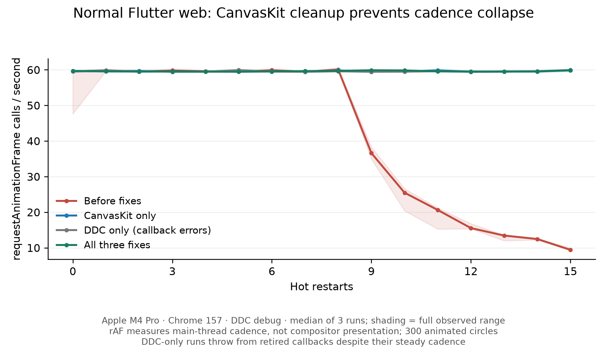
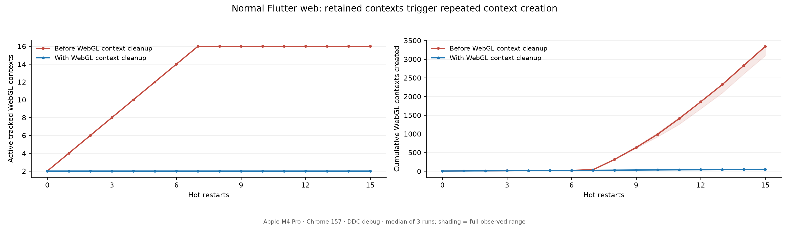
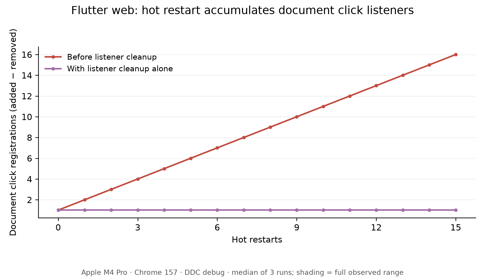
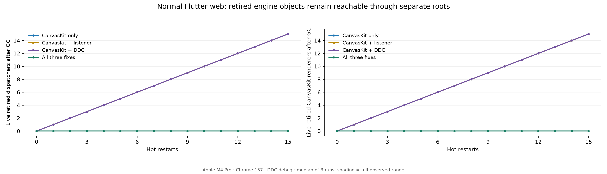
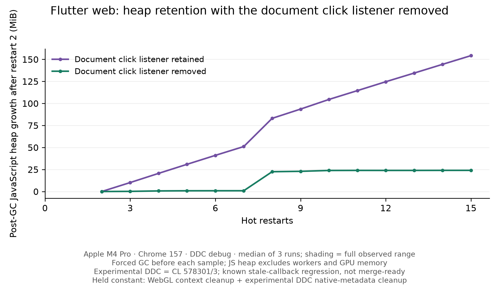
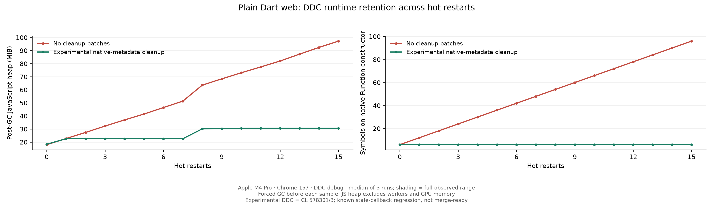

# Desktop reproduction: hot restart outside DartPad

The two Flutter changes fix separate engine cleanup defects and are confirmed
individually: [PR 196786](https://github.com/flutter/flutter/pull/196786)
releases graphics contexts; [PR 196787](https://github.com/flutter/flutter/pull/196787)
removes the document click listener. Neither requires the other or a Dart SDK
patch. The runtime-retention experiment is separate and uses an unsafe,
experimental DDC implementation. [Dependency and reference audit](reference-audit.md).

19 November 2026. These runs use ordinary Flutter web and a compiled plain-Dart
web application. DartPad is absent from both reproductions.

Apple M4 Pro, macOS 27.2, Chrome 157.0.8103.80. Changed DDC/Flutter SDK Dart
libraries were freshly compiled; compiler/VM and CanvasKit binaries are
prebuilt. Source revisions and artifact hashes are in [build-manifest.json](build-manifest.json).

## Ordinary Flutter web

The [fixture](flutter_main.dart) animates 300 circles and holds a 4 MiB payload.
`flutter run -d web-server --machine` and `app.restart(fullRestart: true)` drive
15 restarts in the same page. CanvasKit and its Wasm instance are reused.
Eight combinations, three fresh-page runs each, 384 samples in total.

| Applied changes | rAF calls/s at restart 15 | Active tracked GL contexts | Retired renderer / dispatcher survivors after GC | Heap growth, restarts 10–15 |
| --- | ---: | ---: | ---: | ---: |
| None | 9.41 | 16 | 15 / 15 | 56.64 MiB |
| CanvasKit | 59.93 | 2 | 15 / 15 | 54.96 MiB |
| Click listener | 9.85 | 16 | 15 / 15 | 56.77 MiB |
| CanvasKit + listener | 59.48 | 2 | 15 / 15 | 54.96 MiB |
| Experimental DDC | 59.88* | 15 | 15 / 15 | 49.78 MiB |
| CanvasKit + experimental DDC | 59.75 | 2 | 15 / 15 | 49.80 MiB |
| Listener + experimental DDC | 59.56* | 15 | 15 / 15 | 49.68 MiB |
| CanvasKit + click listener + experimental DDC | 59.86 | 2 | 0 / 0 | 0.13 MiB |

Values are medians. *DDC without CanvasKit cleanup raises 16–17 unhandled
errors per run in stale context-loss callbacks. Those cadence results do
not demonstrate a correct fix.*

### CanvasKit cleanup alone

The context graphs compare the original engine with PR 196786 alone. The
original dispatcher and DDC runtime/loader are used in both conditions.





### Document click-listener cleanup alone

The listener graph compares the original engine with PR 196787 alone. After
15 restarts the baseline has 16 registrations and no removals; the patched
engine has 16 registrations and 15 removals. Registrations minus removals
therefore grow from 1 to 16 before the fix, and stay at 1 with it. The
[probe](probe.js) counts capturing document click add/remove calls in this
fixture; the separate engine regression checks callback identity and capture
flags. CanvasKit and the DDC runtime/loader are unchanged.



### Additional experiment: dispatcher collection

Removing the document listener does not remove other references to a retired
dispatcher. To observe collection after GC, this additional comparison holds
CanvasKit cleanup and experimental DDC native-metadata cleanup constant, then
changes only the click-listener cleanup. All 15 old dispatchers survive in
`context-ddc`; none survive in `all`. This is a condition for the collection
measurement, not a dependency for reviewing or landing either Flutter PR.





The renderer survivor counts match the dispatcher counts in this fixture.
Those counts and all eight combinations remain in the raw data. The DDC patch
used in this additional experiment has a known stale-callback regression;
[the tested source and status](DDC-EXPERIMENT.md) are archived with the data.

The baseline creates a median 3,344 contexts cumulatively; CanvasKit cleanup
reduces that to 49, including initial capability probes and new generations.
Cumulative creation is distinct from simultaneous active-context counts.

## Plain Dart web

The [fixture](plain_main.dart) is compiled with DDC canary/library bundles and
uses neither Flutter nor DartPad. After 15 restarts, native `Function` symbols
grow from 6 to 96 with the original runtime, and stay at 6 with experimental
CL 578301/3. Median post-GC
heap is 97.25 versus 30.57 MiB; growth over restarts 10–15 is 24.21 versus
0.001 MiB. Three before/after pairs produce 96 samples.



The typed-array WeakRef probe retains one JS array in both conditions;
it does not establish retention of arbitrary application data.
The same app compiled with dart2js and dart2wasm produces byte-identical
before/after output: [release-controls.json](release-controls.json).

## Additional DDC cleanup regression

[callback_main.dart](callback_main.dart) installs a DOM callback capturing an
integer and calling `value.toDouble()`. After one canary restart, the original
runtime lets stale and current listeners report 42. With CL 578301, the current
listener reports 42 but the stale listener throws:

```text
Uncaught TypeError: value[$toDouble] is not a function
```

The stale listener survives restart before the patch; the unhandled exception
is introduced by deleting its native extension key. See
[raw result](stale-callback-results.json) and [harness](check_stale_callback.mjs).
This overlaps the callback policy in [SDK issue 56127](https://github.com/dart-lang/sdk/issues/56127).

In Flutter the corresponding error is
`_engine.webGLVersion[$toDouble] is not a function` from retired CanvasKit
callbacks. PR 196786 removes those listeners. The combined Flutter runs are
error-free, but do not resolve the general plain-Dart callback contract.
This integration observation concerns the experimental DDC implementation;
the two Flutter PRs fix their own cleanup defects independently.
If this approach is shipped, the patched loader and rebuilt DDC runtime must
be delivered together. CL 578301 should not be
presented as independently safe based on these measurements.

## Validation and limits

The new Flutter regression assertions fail on the base and pass with cleanup.
Targeted suites total **113 passed, 4 existing tests skipped** across Chromium
and full CanvasKit variants. Targeted Dart analysis reports no issues.
The manual native-metadata regression passes 12 restarts with both APIs,
static reset, cross-frame cleanup, preservation of user properties, legacy
reset and collection of a detached frame. The original loader fails `12 !== 6`.
See [validation.txt](validation.txt), [engine-validation.json](engine-validation.json)
and [engine-suite-summary.json](engine-suite-summary.json).

rAF measures main-thread scheduling, not compositor presentation FPS. Heap
samples follow forced GC and exclude workers, total-process PSS and GPU memory.
Even in the combined cleanup experiment, heap grows 24.03 MiB from restart 2 to 15, with a step near
restart 8 and a later plateau; that step's cause was not profiled.

Baseline runs were first, other variants in forward/reverse/forward order;
this is not a fully randomized experiment. SDK builds overlapped the first
baseline; two subsequent baselines reproduced the drop without build load.
No phone or simulator was used; older mobile data are separate.

## Sources and reproduction files

- [Flutter PR 196786](https://github.com/flutter/flutter/pull/196786),
  [Flutter PR 196787](https://github.com/flutter/flutter/pull/196787),
  [Dart CL 578301, patchset 3](https://dart-review.googlesource.com/c/sdk/+/578301/3).
- [Detailed German report](README.md) and [source analysis](source-analysis.md).
- [Flutter JSON](flutter-results.json), [Flutter CSV](flutter-samples.csv),
  [plain-Dart JSON](plain-results.json), [plain-Dart CSV](plain-samples.csv),
  [summary](summary.json), [environment](environment.json).
- [Build](build_web_sdks.py), [Flutter preparation](prepare_flutter_run.py),
  [Flutter measurement](measure_flutter.mjs), [plain-Dart measurement](measure_plain.mjs),
  [CDP helper](cdp.mjs), [probe](probe.js), [plots](plot_results.py).

Scripts run from a checkout root with this directory at
`docs/research/hot-restart-2026-11-19`. Build inputs and the dedicated Chrome
profile/port are described in the German report. Local input paths must be
adapted to matching checkouts; this bundle does not contain SDK binaries.
All six graphs are also available as SVG alongside their PNG versions.
